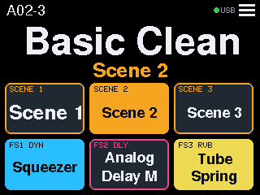
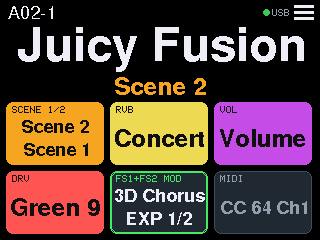
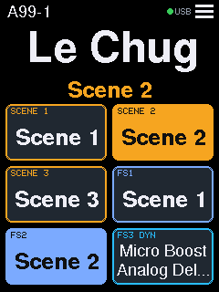
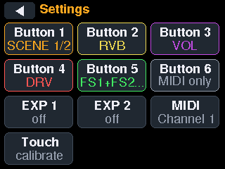
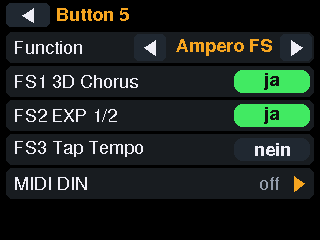
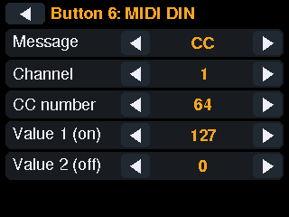
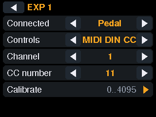
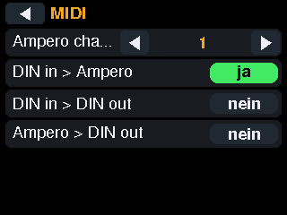

# AmperoDisplayPico2 – Raspberry Pi Pico 2 + HY28B

Touch-Fußleiste für den **Hotone Ampero II (Stomp)**: ein **HY28B** (2,8", ILI9325, 320×240, SPI, Touch XPT2046)
an einem **Raspberry Pi Pico 2** (RP2350). Der Ampero hängt über **PIO-USB an GP12 (D−) / GP13 (D+)**; der
Micro-USB-Port des Pico bleibt für Programmierung, Stromversorgung und Serial-Log frei.

* **Anzeige:** oben links die Preset-Nummer wie am Gerät (A00-1 … A99-3), darunter groß der Preset-Name,
  darunter in Orange der Name der **aktiven Szene**, dann **sechs gleich große Kacheln** – jede ist ein
  Touch-Fußschalter. Ganz rechts oben das Menü-Symbol (☰), daneben eine kleine USB-Anzeige.
* **Sprache:** alle Texte auf dem Display und im Log sind englisch.
* **Kacheln einstellbar** (im Touch-Menü): Szene wählen, zwischen zwei Szenen wechseln, einen **Effekt-Block
  an/aus** schalten (fester Slot oder „erster Block dieses Typs“, z. B. RVB) oder die Funktion von
  **Fußschalter 1, 2 und/oder 3 des Ampero** übernehmen. Zusätzlich kann jede Kachel eine **MIDI-Nachricht
  auf MIDI-DIN** senden (CC mit Wechselwerten, PC oder Note).
* **Effekt-Typ und -Farbe:** Kacheln für Blöcke zeigen den Typ klein oben links (DYN, AMP, CAB, MOD, VOL,
  RVB …) und die Farbe des Typs wie im Hotone-Editor (RVB gelb, VOL lila, DLY pink, DRV rot, MOD grün …).
  **Gefüllt = an**, dunkel mit farbigem Rahmen = aus.
* **Zwei EXP-Anschlüsse** (Klinke): wahlweise **Expression-Pedal** (Ampero EXP 1/EXP 2, Patch-Volume,
  Quick Para 1–3 oder ein beliebiger CC auf MIDI-DIN; mit Kalibrierung) oder **Fußschalter** (Taster
  oder rastend) mit denselben Funktionen wie die Kacheln.
* **MIDI-DIN In/Out** (UART0): die Kacheln/EXP-Schalter senden ihre MIDI-Nachrichten; was an MIDI-DIN In
  ankommt, geht wahlweise an den Ampero (USB) und/oder an MIDI-DIN Out (Thru); was der Ampero selbst
  per USB-MIDI sendet (CC/PC/Clock, nicht sein SysEx-Protokoll), wahlweise an MIDI-DIN Out.

| Standard: Szenen + Ampero-FS | Eigene Belegung | Hochformat (`LCD_ROTATION 0`) |
|---|---|---|
|  |  |  |

| Menü | Kachel einstellen | MIDI-DIN einer Kachel | EXP-Port | MIDI-Routing |
|---|---|---|---|---|
|  |  |  |  |  |

(Vorschau-Bilder: PC-Rendering mit den echten Presets aus dem Wireshark-Mitschnitt, `extras/preview`.)

## Bedienung

* **Kachel antippen** = ihre Funktion (sofort beim Berühren, wie ein Fußschalter).
* **Kachel 1 s halten** = Einstellungen dieser Kachel. (Die Funktion wurde beim Berühren schon ausgelöst.)
* **Statusleiste oben antippen** (Zeile mit „A00-1“ und ☰) = Menü: Button 1–6, EXP 1/2, MIDI, Touch
  calibrate. Zurück mit ◄ oben links; beim Verlassen des Menüs wird gespeichert (Flash).
* Werte: ◄ ► (gedrückt halten = schnell weiterzählen), Tipp auf die Zeile = nächster Wert;
  yes/no-Schalter und Links (►) per Tipp.

### Kachel-Funktionen

| Funktion | Einstellung | Was passiert | Kachel zeigt |
|---|---|---|---|
| Scene | Scene 1–3 | Szene wählen (SysEx wie der Editor + CC 25) | Szenenname, orange = aktiv |
| Scene toggle | Scene A, B | wechselt zwischen A und B | beide Namen, aktive oben |
| Block on/off | „Type RVB“ … oder Slot n | schaltet den Block in der aktiven Szene (SysEx `0x01090004`, wie der Editor) | Effektname, Typ, Typ-Farbe |
| Ampero FS | FS1/FS2/FS3 yes/no | tut, was die Fußschalter des Ampero im Preset tun (mehrere = alle nacheinander) | deren Funktion bzw. Effekte |
| off | – | nur die MIDI-Nachricht (falls eingestellt) | „MIDI / CC 64 Ch1“ |

„Type RVB“ nimmt den ersten Reverb-Block des aktuellen Presets – praktisch, weil die Slots je Preset anders
belegt sind. **Ampero-FS:** „Ctrl 1–3“ (Effekte schalten) und „Scene n“ per SysEx; Tap Tempo, Bank ±, Patch ±,
Tuner, Looper-Funktionen, Bypass, EXP 1/2, Drum, A1–B6 On/Off per **MIDI-CC** laut Hotone-MIDI-Tabelle
(Kanal = „Ampero channel“ im MIDI-Menü, muss zum USB-MIDI-Empfangskanal des Ampero passen).

### EXP-Ports

| Anschluss | Einstellungen |
|---|---|
| Pedal | **Controls:** Ampero EXP 1 (CC 13 = 0, CC 11), Ampero EXP 2 (CC 13 = 127, CC 11), Patch volume (CC 7, 0–100), Quick Para 1/2/3 (CC 16/18/20), MIDI DIN CC (Kanal, Nummer). **Calibrate:** Pedal auf Ferse → „Heel: tap here“, auf Spitze → „Toe: tap here“ (umgekehrt = Pedal läuft rückwärts). |
| Switch | **Function:** wie eine Kachel (inkl. MIDI DIN). **Switch type:** momentary (Öffner oder Schließer, Ruhelage wird beim Einstellen/Start erkannt) oder latching (jede Umschaltung = ein Druck). |

### MIDI

| Einstellung | Standard | Bedeutung |
|---|---|---|
| Ampero channel | 1 | Kanal der CC-Befehle an den Ampero |
| DIN in > Ampero | yes | alles von MIDI-DIN In geht per USB an den Ampero |
| DIN in > DIN out | no | MIDI-Thru (nachrichtenweise, Clock sofort) |
| Ampero > DIN out | no | was der Ampero per USB-MIDI sendet (außer seinem SysEx-Protokoll) |

## Verdrahtungsplan

Pin = physischer Pin des Pico 2 (1–40, Pin 1 oben links neben dem Micro-USB-Stecker).

```
                         Raspberry Pi Pico 2
   PC / 5-V-Netzteil ══► Micro-USB (Flashen, Strom, Serial-Log)

   Pin 40 VBUS  ───────┬──────────────────────────────► HY28B Pin 1  (5V_IN)
                       └──────────────────────────────► USB-Buchse VBUS (5 V für den Ampero)
   Pin 38 GND   ───────┬──────────────────────────────► HY28B Pin 2  (GND)
                       └──────────────────────────────► USB-Buchse GND

   Pin 16 GP12 ──[22 Ω]───────────────────────────────► USB-Buchse D−
   Pin 17 GP13 ──[22 Ω]───────────────────────────────► USB-Buchse D+
   (keine externen 15-kΩ-Pulldowns – am Ampero getestet: mit ihnen wird er nicht erkannt)

   Pin 21 GP16 (SPI0 RX)  ◄───────────────────────────  HY28B Pin 16 (LCD_SDO)   optional
   Pin 22 GP17 (CS)       ───────────────────────────►  HY28B Pin 11 (LCD_CS)
   Pin 24 GP18 (SPI0 SCK) ───────────────────────────►  HY28B Pin 13 (LCD_SCK)
   Pin 25 GP19 (SPI0 TX)  ───────────────────────────►  HY28B Pin 17 (LCD_SDI)
   Pin 26 GP20            ───────────────────────────►  HY28B Pin 15 (RESET)
   Pin 27 GP21 (PWM)      ───────────────────────────►  HY28B Pin 40 (BL_CTRL)

   Touch (XPT2046) – eigener Bus SPI1:
   Pin 14 GP10 (SPI1 SCK) ───────────────────────────►  HY28B Pin 33 (TP_SCK)
   Pin 15 GP11 (SPI1 TX)  ───────────────────────────►  HY28B Pin 34 (TP_SDI)
   Pin 11 GP8  (SPI1 RX)  ◄───────────────────────────  HY28B Pin 35 (TP_SDO)
   Pin 12 GP9  (CS)       ───────────────────────────►  HY28B Pin 32 (TP_CS)
   Pin 29 GP22            ◄───────────────────────────  HY28B Pin 36 (TP_IRQ)

   MIDI-DIN (UART0, 31250 Baud):
   Pin 36 3V3(OUT) ──[33 Ω]──────────────────────────►  MIDI OUT Buchse Pin 4
   Pin 1  GP0 (TX) ──[10 Ω]──────────────────────────►  MIDI OUT Buchse Pin 5
   Pin 3  GND ───────────────────────────────────────►  MIDI OUT Buchse Pin 2 (Schirm)
   Pin 2  GP1 (RX) ◄──── Optokoppler-Ausgang (H11L1 Pin 5, 1 kΩ nach 3,3 V)  ◄── MIDI IN

   EXP-Ports (6,3-mm-Stereo-Klinkenbuchsen, TRS):
   Pin 31 GP26 (ADC0) ◄──[1 kΩ]──┬──  EXP 1 Spitze (Tip)     ┐ 100 nF von GP26/27
   Pin 32 GP27 (ADC1) ◄──[1 kΩ]──┬──  EXP 2 Spitze (Tip)     ┘ nach AGND (Pin 33)
   Pin 36 3V3(OUT) ──[1 kΩ]──────────► EXP 1 und EXP 2 Ring
   Pin 33 AGND ──────────────────────► EXP 1 und EXP 2 Hülse (Sleeve)
```

### MIDI-DIN (3,3 V)

**MIDI OUT** (nach MIDI-Spezifikation für 3,3-V-Sender):

| Pico 2 | Bauteil | 5-pol. DIN-Buchse (Lötseite) |
|---|---|---|
| Pin 36 3V3(OUT) | 33 Ω | Pin 4 |
| Pin 1 GP0 (UART0 TX) | 10 Ω | Pin 5 |
| Pin 3 GND | – | Pin 2 (Schirm) |

**MIDI IN** (galvanisch getrennt, Optokoppler **H11L1** – läuft an 3,3 V; 6N138 ist für 5 V spezifiziert):

| DIN-Buchse | Bauteil | H11L1 | Pico 2 |
|---|---|---|---|
| Pin 4 | 220 Ω | Pin 1 (Anode) | |
| Pin 5 | | Pin 2 (Kathode) | |
| | 1N4148 antiparallel zwischen H11L1 Pin 1 und 2 (Kathode an Pin 1) | | |
| | | Pin 6 (VCC) + 100 nF nach GND | Pin 36 3V3(OUT) |
| | | Pin 4 (GND) | Pin 3 GND |
| | 1 kΩ von Pin 5 nach 3,3 V | Pin 5 (Ausgang) | **Pin 2 GP1 (UART0 RX)** |

Pin 2 der MIDI-IN-Buchse bleibt offen (keine Masseverbindung, sonst Brummschleifen).

### EXP-Ports

Eine Stereo-Klinkenbuchse je Port: **Hülse** an AGND, **Ring** über 1 kΩ an 3,3 V, **Spitze** über 1 kΩ an
GP26 (EXP 1) bzw. GP27 (EXP 2), dazu 100 nF von GP26/GP27 nach AGND.

* **Expression-Pedal** (TRS, Poti 10–50 kΩ zwischen Ring und Hülse, Schleifer an der Spitze): im Menü
  „Connected: Pedal“ und einmal kalibrieren. Die 1 kΩ am Ring begrenzen den Strom, falls ein Mono-Stecker
  Ring und Hülse kurzschließt; sie verkleinern den Messbereich etwas, das gleicht die Kalibrierung aus.
  Pedale mit Poti zwischen Spitze und Hülse und Ring = Schleifer (einige Hersteller) brauchen ein Adapterkabel.
* **Fußschalter** (Mono- oder Stereostecker, Kontakt zwischen Spitze und Hülse): „Connected: Switch“. Der Pico
  schaltet dann den internen Pull-up ein; Öffner und Schließer funktionieren beide (Ruhelage wird erkannt).

### Pico 2 → HY28B Touch

| Pico 2 | HY28B Pin | HY28B Signal | Hinweis |
|---|---|---|---|
| Pin 14 GP10 | 33 | TP_SCK | SPI1 SCK |
| Pin 15 GP11 | 34 | TP_SDI | SPI1 TX (MOSI) |
| Pin 11 GP8 | 35 | TP_SDO | SPI1 RX (MISO) – **wird gebraucht** (Messwerte) |
| Pin 12 GP9 | 32 | TP_CS | Chip-Select, low-aktiv |
| Pin 29 GP22 | 36 | TP_IRQ | low bei Berührung (interner Pullup aktiv) |

Der Touch-Controller wird vom 3,3-V-Regler des Moduls versorgt, es braucht also nur diese fünf Signalleitungen
(GND ist schon über Pin 2 verbunden). Er läuft auf einem eigenen SPI-Bus (Modus 0, 2 MHz) und stört so die
Display-Übertragung (Modus 3, 16 MHz) nicht.

### Pico 2 → USB-OTG-Buchse (Ampero)

| Pico 2 | Buchse | Hinweis |
|---|---|---|
| Pin 40 VBUS | VBUS (USB-A Pin 1) | **5 V für den Ampero** – ohne VBUS schlägt die Anmeldung fehl |
| Pin 16 GP12 | D− (USB-A Pin 2, weiß) | optional 22 Ω **in Reihe** |
| Pin 17 GP13 | D+ (USB-A Pin 3, grün) | optional 22 Ω **in Reihe** |
| Pin 18/38 GND | GND (USB-A Pin 4) | |
| – | **keine** 15-kΩ-Pulldowns | Pico-PIO-USB nutzt die internen Pulldowns der GPIOs. Mit externen 15 kΩ wurde der Ampero im Test nicht erkannt (Leitungen blieben low). |

* D+ und D− müssen benachbarte GPIOs sein, die Reihenfolge ist egal: im Sketch `PIN_USB_DP`/`PIN_USB_DM`
  passend setzen (Standard: D+ GP13, D− GP12). Vertauscht = Gerät wird nicht erkannt.
* D+/D− kurz (wenige cm), gleich lang, verdrillt führen.
* Optional 10 µF + 100 nF zwischen VBUS und GND direkt an der Buchse.
* Bei einer **USB-C-Buchse** (dann C-auf-C-Kabel zum Ampero): D+ an A6 **und** B6, D− an A7 **und** B7,
  VBUS an A4/A9/B4/B9, GND an A1/A12/B1/B12, und **je 56 kΩ von CC1 (A5) und CC2 (B5) nach VBUS**.

### Pico 2 → HY28B (40-polige Stiftleiste, 2,0 mm Raster)

| Pico 2 | HY28B Pin | HY28B Signal | Hinweis |
|---|---|---|---|
| Pin 40 VBUS | 1 | 5V_IN | Modul hat einen eigenen 3,3-V-Regler; Logikpegel 3,3 V |
| Pin 38 GND | 2 | GND | (19, 22, 39 sind ebenfalls GND) |
| Pin 24 GP18 | 13 | LCD_SCK | SPI0 SCK |
| Pin 25 GP19 | 17 | LCD_SDI | SPI0 TX (MOSI) |
| Pin 21 GP16 | 16 | LCD_SDO | SPI0 RX – wird nicht gelesen, darf offen bleiben |
| Pin 22 GP17 | 11 | LCD_CS | Chip-Select, low-aktiv |
| Pin 26 GP20 | 15 | RESET | low-aktiv |
| Pin 27 GP21 | 40 | BL_CTRL | Hintergrundbeleuchtung (PWM) |
| – | 12 | RS | **nicht verbinden** – im SPI-Modus steckt RS im Startbyte |
| – | 3–10, 23–30 | D10–D17, D0–D7 | nicht verbinden |
| siehe oben | 32–36 | TP_* | Touch an SPI1 |
| – | 20/21 | 3V3_IN/OUT | offen lassen |

**IM-Jumper** auf dem HY28B: Werkseinstellung SPI (IM2 = 1, IM1 = 0, IM0 = 0).

Stromversorgung: alles kommt über den Micro-USB-Port des Pico (PC oder 5-V-Netzteil, ≥ 500 mA).
VBUS (Pin 40) ist direkt mit der Micro-USB-Buchse verbunden. Der Ampero läuft an seinem eigenen Netzteil.

### Belegte Pins (Übersicht)

GP0/GP1 MIDI · GP8–GP11 + GP22 Touch · GP12/GP13 USB-Host · GP16–GP21 Display · GP26/GP27 EXP.
Frei: GP2–GP7, GP14, GP15, GP28.

## Arduino-IDE

* Boardverwalter: **Raspberry Pi Pico/RP2040/RP2350 (earlephilhower)**, kompiliert mit 6.1.1
* Board: **Raspberry Pi Pico 2**, CPU Architecture: **ARM**,
  CPU Speed: **120 MHz** (nicht die Voreinstellung 150 MHz – PIO-USB braucht 120 oder 240 MHz),
  USB Stack: **Adafruit TinyUSB**
* Bibliotheken: **Adafruit TinyUSB Library** (3.7.7), **Pico PIO USB** (0.7.3), **Adafruit GFX Library**
* **Einmalige Anpassung** in
  `Dokumente\Arduino\libraries\Adafruit_TinyUSB_Library\src\arduino\ports\rp2040\tusb_config_rp2040.h`:

  ```c
  #define CFG_TUH_ENUMERATION_BUFSIZE 1024   // statt 256
  ```

  Der Konfigurationsdeskriptor des Ampero ist 505 Byte lang; mit 256 bricht TinyUSB die Enumeration ab.
  Der Sketch prüft das beim Kompilieren (`#error`).
* **Pico PIO USB ab 0.7.3 verwenden.** 0.7.2 hat einen Fehler
  ([Issue #197](https://github.com/sekigon-gonnoc/Pico-PIO-USB/issues/197)): Nach jedem gesendeten Paket wartet
  `pio_usb_bus_usb_transfer()` auf einen Programmzähler-Wert der PIO, den es verpassen kann – dann hängt der
  USB-Kern nach einiger Zeit für immer. 0.7.3 behebt das (Commit 99cdec5). Wer bei 0.7.2 bleiben muss:
  `extras/pio_usb_fix/pio_usb.c` (nur für 0.7.2!) nach `Dokumente\Arduino\libraries\Pico_PIO_USB\src\pio_usb.c`
  kopieren (Änderung: `extras/pio_usb_fix/pio_usb_issue197.diff`).
* Display-Tempo: Es werden nur die 30-Pixel-Streifen übertragen, die sich geändert haben (Prüfsumme je
  Streifen), mit `LCD_SPI_HZ` = 30 MHz. Bei Bildfehlern `LCD_SPI_HZ` auf 16000000 senken. Das Log zeigt
  je Bildaufbau `Display: n ms, k/8 strips sent`.
* Einstellungen im Sketch: `LCD_ROTATION` (90/270 quer, 0/180 hoch), `LCD_SPI_HZ`, `LCD_BRIGHTNESS`,
  `TILE_HOLD_MS`, Pins. Alles andere im Touch-Menü (gespeichert im Flash hinter der Touch-Kalibrierung).
* Log: Serieller Monitor auf dem Micro-USB-Port, 115200 Baud. Erwartet:
  `USB: device 84ef:0030 mounted` und `USB MIDI connected`; bei jedem Tipp `Touch: x/y -> tile n`,
  alle 2 s bei Verkehr `MIDI: USB … DIN in n, out n messages`.

## Dateien

| Datei | Inhalt |
|---|---|
| `AmperoDisplayPico2.ino` | Pins, Touch-Steuerung, MIDI-Routing, USB-Host (Core 1) |
| `AmperoClient.*` | SysEx-Protokoll des Ampero: Preset/Szene lesen, Szene/Blöcke schalten, Fußschalter-Funktionen |
| `Controller.*` | was Kacheln und EXP-Ports tun, Kachel-Inhalte |
| `Menu.*` | Touch-Menü |
| `Config.*` | Einstellungen im Flash |
| `MidiDin.*`, `MidiParser.h` | MIDI-DIN (UART0), MIDI-Parser (auch für USB) |
| `Screen.*`, `Categories.h` | Zeichnen (Hauptbild, Menü, Kalibrierung), Effekt-Typen und -Farben |
| `AlgNames.h` | Effektnamen (erzeugt mit `tools/gen_alg_names.py` aus der Editor-Datenbank) |
| `Ili9325Spi.*`, `StripCanvas.h`, `Xpt2046.*` | Display-, Zeichenpuffer- und Touch-Treiber |

## Touch-Kalibrierung

3 Kreuze nacheinander antippen, am besten mit dem Stift. Startet automatisch beim ersten Einschalten, beim
Einschalten mit **gedrücktem Display** oder über **Menü → Touch calibrate**. Die Werte werden im Flash
gespeichert; Drehung, Spiegelung und vertauschte Achsen des Touch-Panels werden von selbst erkannt.

## Getestet / nicht getestet

Getestet:
* Kompiliert (Pico 2/ARM, 120 MHz, TinyUSB mit Puffer-Patch, Pico PIO USB 0.7.3): 154 KB Flash, 51 KB RAM
  + Puffer (Streifen 19 KB, Queues 19 KB).
* Am Gerät (vom Nutzer): Erkennung, Preset/Szenen lesen, Szenenwechsel, Fußschalter-Anzeige mit Status.
* `extras/touch_test` (PC): Kalibrierung für vier Panel-Lagen, alle sechs Kacheln gleich groß und treffsicher
  (quer und hoch), Menü-Treffertest (Zurück, Pfeile, Zeilen), MIDI-Parser (Running Status, Clock mitten in
  Nachrichten und SysEx, System Common, zu langes SysEx), Einstellungen speichern/laden/beschädigt.
* `extras/preview` (PC): Hauptbild mit den echten Presets und verschiedenen Belegungen, alle Menüseiten.

Nicht getestet (keine Hardware hier):
* **Block schalten** per SysEx `0x01090004` (Format aus dem Editor-Quelltext) und die **CC-Funktionen**
  (Tap Tempo, Tuner, Looper, EXP 1/2 …) am Ampero – ob der Ampero CCs über USB annimmt, hängt von seinem
  USB-MIDI-Empfangskanal ab.
* MIDI-DIN-Schaltung, EXP-Ports, Speichern im Flash am Gerät (beim Schreiben pausiert Core 1 kurz;
  im ungünstigsten Fall meldet sich der Ampero danach neu an).
* Touch reagiert gar nicht → Log prüfen; `TP_IRQ` muss bei Berührung auf low gehen, `TP_SDO` muss verbunden sein.
  Reagiert er zu schwach, in `Xpt2046.cpp` `kMinPressure` senken.
