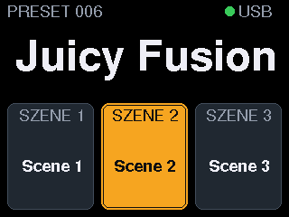
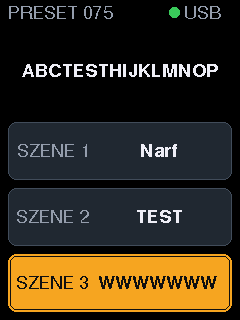

# AmperoDisplayRP2040 – RP2040-Zero + HY28B

Zeigt **Preset-Name**, die **drei Szenen-Namen** und die **aktive Szene** (orange) eines Ampero II (Stomp)
auf einem **HY28B** (2,8", ILI9325, 320×240, SPI) an einem **Waveshare RP2040-Zero**.
Der Ampero hängt über **PIO-USB** (2 GPIOs) am RP2040; der USB-C-Port des RP2040-Zero bleibt für
Programmierung, Stromversorgung und Serial-Log frei.

| Querformat (Standard) | Hochformat (`LCD_ROTATION 0`) |
|---|---|
|  |  |

## Verdrahtungsplan

```
                    ┌──────────────────────────┐
   PC / USB-Netzteil│ USB-C   RP2040-Zero      │
   ════════════════►│ (Flashen, Strom, Log)    │
                    │                          │
                    │ 5V ──────────────┬───────┼──────────────► HY28B Pin 1  (5V_IN)
                    │                  └───────┼──────────────► USB-A Pin 1  (VBUS)
                    │ GND ─────────────┬───────┼──────────────► HY28B Pin 2  (GND)
                    │                  └───────┼──────────────► USB-A Pin 4  (GND)
                    │                          │
                    │ GP2  (SPI0 SCK) ─────────┼──────────────► HY28B Pin 13 (LCD_SCK)
                    │ GP3  (SPI0 TX)  ─────────┼──────────────► HY28B Pin 17 (LCD_SDI)
                    │ GP4  (SPI0 RX)  ◄────────┼─────────────── HY28B Pin 16 (LCD_SDO)  optional
                    │ GP5  ────────────────────┼──────────────► HY28B Pin 11 (LCD_CS)
                    │ GP6  ────────────────────┼──────────────► HY28B Pin 15 (RESET)
                    │ GP7  (PWM) ──────────────┼──────────────► HY28B Pin 40 (BL_CTRL)
                    │                          │
                    │ GP14 (USB D+) ──[22 Ω]───┼──────────────► USB-A Pin 3  (D+, grün)
                    │ GP15 (USB D−) ──[22 Ω]───┼──────────────► USB-A Pin 2  (D−, weiß)
                    └──────────────────────────┘
                                                  USB-A-Buchse ══ dein USB-C→USB-A-Kabel ══► Ampero
```

### RP2040-Zero → HY28B (40-polige Stiftleiste, 2,0 mm Raster)

| RP2040-Zero | HY28B Pin | HY28B Signal | Hinweis |
|---|---|---|---|
| 5V | 1 | 5V_IN | Modul hat einen eigenen 3,3-V-Regler; Logikpegel 3,3 V |
| GND | 2 | GND | (19, 22, 39 sind ebenfalls GND) |
| GP2 | 13 | LCD_SCK | SPI0 SCK |
| GP3 | 17 | LCD_SDI | SPI0 TX (MOSI) |
| GP4 | 16 | LCD_SDO | SPI0 RX (MISO) – wird nicht gelesen, darf offen bleiben |
| GP5 | 11 | LCD_CS | Chip-Select, low-aktiv |
| GP6 | 15 | RESET | low-aktiv |
| GP7 | 40 | BL_CTRL | Hintergrundbeleuchtung (PWM) |
| – | 12 | RS | **nicht verbinden** – im SPI-Modus steckt RS im Startbyte (wie im Linux-Treiber fbtft) |
| – | 3–10, 23–30 | D10–D17, D0–D7 | nicht verbinden (Parallelbus) |
| – | 32–36 | TP_* | Touch, wird nicht benutzt – offen lassen |
| – | 20/21 | 3V3_IN/OUT | offen lassen (Versorgung über 5V_IN) |

**IM-Jumper** auf dem HY28B: Werkseinstellung = SPI (IM2 = 1, IM1 = 0, IM0 = 0). Nicht auf 8/16 Bit umlöten.

### RP2040-Zero → USB-A-Buchse (für das Ampero-Kabel)

| RP2040-Zero | USB-A-Buchse | Hinweis |
|---|---|---|
| 5V | Pin 1 VBUS (rot) | **wichtig:** der Ampero braucht 5 V auf VBUS, sonst schlägt der USB-Reset fehl |
| GP15 | Pin 2 D− (weiß) | über 22 Ω in Reihe |
| GP14 | Pin 3 D+ (grün) | über 22 Ω in Reihe; D− muss immer D+ + 1 sein |
| GND | Pin 4 GND (schwarz) | |

* D+/D− kurz (wenige cm), gleich lang, verdrillt führen.
* Optional 10 µF + 100 nF zwischen VBUS und GND direkt an der Buchse.
* Statt USB-A geht auch eine **USB-C-Buchse** (dann C-auf-C-Kabel): D+ an A6 **und** B6, D− an A7 **und** B7,
  VBUS an A4/A9/B4/B9, GND an A1/A12/B1/B12, und **je 56 kΩ von CC1 (A5) und CC2 (B5) nach VBUS**.
* Stromversorgung: alles kommt aus dem USB-C-Port des RP2040-Zero (PC oder 5-V-Netzteil, ≥ 500 mA).
  Der Ampero läuft an seinem eigenen Netzteil und zieht über VBUS praktisch nichts.

## Arduino-IDE

* Boardverwalter: **Raspberry Pi Pico/RP2040/RP2350 (earlephilhower)**, kompiliert mit 6.1.1
* Board: **Waveshare RP2040 Zero**, CPU Speed: **120 MHz**, USB Stack: **Adafruit TinyUSB**
* Bibliotheken: **Adafruit TinyUSB Library** (3.7.7), **Pico PIO USB** (0.7.2), **Adafruit GFX Library**
* **Einmalige Anpassung** in
  `Dokumente\Arduino\libraries\Adafruit_TinyUSB_Library\src\arduino\ports\rp2040\tusb_config_rp2040.h`:

  ```c
  #define CFG_TUH_ENUMERATION_BUFSIZE 1024   // statt 256
  ```

  Der Konfigurationsdeskriptor des Ampero ist 505 Byte lang (siehe Wireshark-Mitschnitt); mit 256 bricht
  TinyUSB die Enumeration ab. Der Sketch prüft das beim Kompilieren (`#error`). Die Änderung geht bei einem
  Update der Bibliothek verloren.
* Einstellungen im Sketch: `LCD_ROTATION` (90/270 quer, 0/180 hoch), `LCD_SPI_HZ`, `LCD_BRIGHTNESS`, Pins.
* Log: Serieller Monitor auf dem USB-C-Port, 115200 Baud.

## Aufbau des Sketches

| Datei | Inhalt |
|---|---|
| `AmperoDisplayRP2040.ino` | Core 1: PIO-USB-Host + TinyUSB-MIDI-Host; Core 0: Protokoll + Anzeige; zwei Queues dazwischen |
| `AmperoClient.*` | Ampero-Protokoll (identisch mit der ESP32-Version, gegen den Mitschnitt getestet) |
| `Ili9325Spi.*` | ILI9325-SPI-Treiber: Startbyte 0x70/0x72, SPI-Modus 3, Init/Gamma/Rotation aus fbtft „hy28b“ |
| `StripCanvas.h` | Adafruit-GFX-Ziel mit 30-Zeilen-Streifen (19 KB statt 150 KB Framebuffer) |
| `Screen.*` | Layout, skaliert mit der Displaygröße |

## Getestet / nicht getestet

Getestet:
* Kompiliert (Core 6.1.1, 120 MHz, Adafruit TinyUSB 3.7.7 mit Puffer-Patch): 120 KB Flash, 47 KB RAM + 19 KB Streifenpuffer.
* Protokoll: der PC-Host-Test aus `../AmperoDisplay/extras/host_test` läuft mit dieser `AmperoClient.cpp` grün.
* Layout inkl. Streifen-Rendering: `extras/preview` rendert über denselben `StripCanvas` (Bilder oben).
* Der TinyUSB-MIDI-Host passt zur Interface-Struktur des Ampero: UAC2-Audio (IAD, Interfaces 0–2) plus
  separate MIDI-Funktion (Audio Control 3 + MIDI Streaming 4) – genau der Fall „Audio Control + MIDI“ im Treiber.

Nicht getestet (keine Hardware hier):
* Display: Init-Sequenz, Rotation und Gamma stammen aus dem Linux-Treiber für genau dieses Modul.
  Falls das Bild gespiegelt/gedreht ist: `LCD_ROTATION` ändern. Falls die Farben vertauscht sind (Rot↔Blau):
  in `Ili9325Spi.cpp` `BGR` auf `0x0000` setzen. Bei Bildfehlern `LCD_SPI_HZ` auf 8000000 senken.
* USB Full-Speed am Ampero (PIO-USB ist wie der ESP32-S3 nur Full-Speed) – siehe Log: erwartet werden
  `USB: Gerät 84ef:0030 angemeldet` und `USB-MIDI verbunden`.
