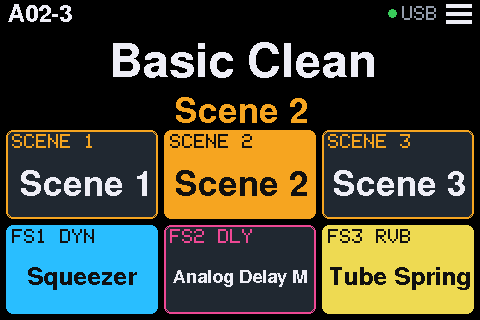
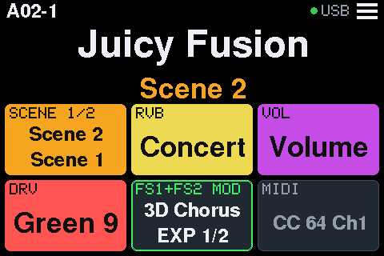
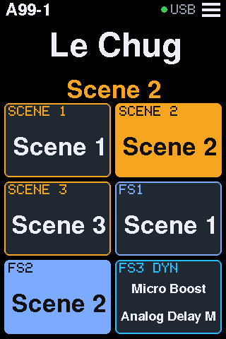
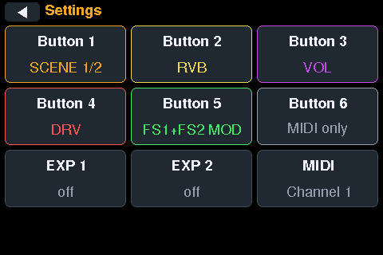
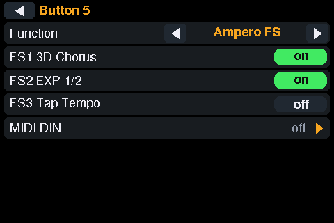
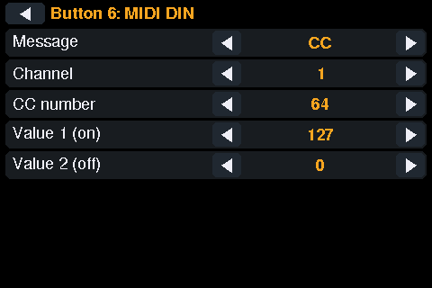
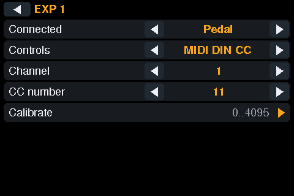
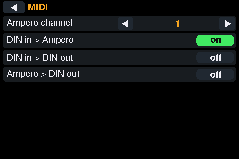

# AmperoDisplayS3 – ESP32-S3 + MAX3421E + 3,5" ST7796U

Touch-Fußleiste für den **Hotone Ampero II (Stomp)**, Variante mit
* **ESP32-S3 DevKitC-1 N16R8** (16 MB Flash, 8 MB Octal-PSRAM),
* **MAX3421E-USB-Host-Board** (z. B. „USB Host Shield Mini“) für den Ampero,
* **3,5"-IPS-Display 320×480, ST7796U, 4-Line-SPI**, mit **kapazitivem Touch FT6336U (I2C)**,
  angesteuert über **TFT_eSPI**.

Funktionen wie bei `AmperoDisplayPico2` (Anzeige, sechs einstellbare Kacheln, zwei EXP-Ports, MIDI-DIN
In/Out mit Routing, Menü). Unterschiede:
* **480×320** (quer) bzw. 320×480 (hoch): größere Schriften in Kacheln, Statuszeile und Szenenzeile.
* **Keine Touch-Kalibrierung** mehr nötig (kapazitiv, feste Koordinaten) – der Menüpunkt entfällt.
* USB-Host per MAX3421E statt PIO-USB: kein Taktvorgaben-Zwang, keine D+/D−-Pin-Fragen.
* Beide USB-Buchsen des DevKitC bleiben frei (Flashen, Strom, Serial-Log 115200).

| Standard: Szenen + Ampero-FS | Eigene Belegung | Hochformat (`LCD_ROTATION 0`) |
|---|---|---|
|  |  |  |

| Menü | Kachel einstellen | MIDI-DIN einer Kachel | EXP-Port | MIDI-Routing |
|---|---|---|---|---|
|  |  |  |  |  |

Bedienung, Kachel-Funktionen, EXP- und MIDI-Einstellungen: siehe `../AmperoDisplayPico2/README.md`
(identisch, nur ohne „Touch calibrate“).

## Aufteilung auf die Kerne

| Kern | Was |
|---|---|
| Core 1 (Arduino `loop()`) | USB-Host (TinyUSB + MAX3421E), Packen der USB-MIDI-Pakete (≤ 60 Byte je Transfer, kein ZLP). Der Interrupt-Task der Bibliothek für den MAX3421E läuft ebenfalls hier. |
| Core 0 (Task `ui`) | Ampero-Protokoll, Display, Touch, Menü, EXP-Ports, MIDI-DIN |

Austausch über zwei FreeRTOS-Queues (wie vorher beim Pico zwischen den Kernen).

## Verdrahtungsplan

Pins = GPIO-Nummern des DevKitC-1 (stehen auf der Platine). **Nicht verwenden:** GPIO 35–37 (Octal-PSRAM),
19/20 (USB), 43/44 (UART-Log), 0/3/45/46 (Strapping), 38/48 (RGB-LED je nach Board-Version).

```
                      ESP32-S3 DevKitC-1 N16R8
   PC ══► USB-Buchse "UART" oder "USB" (Flashen, Strom, Serial-Log)

   Display ST7796U (SPI2, eigener Bus)            Display-Modul
   5V   ──────────────────────────────────────►  VCC   (Modul arbeitet mit 5 V)
   GND  ──────────────────────────────────────►  GND
   GPIO10 ────────────────────────────────────►  CS
   GPIO8  ────────────────────────────────────►  RESET
   GPIO9  ────────────────────────────────────►  DC / RS
   GPIO11 ────────────────────────────────────►  SDI (MOSI)
   GPIO12 ────────────────────────────────────►  SCK
   GPIO14 ────────────────────────────────────►  LED   (Hintergrundlicht, PWM)
                                                  SDO (MISO) bleibt offen
   Touch FT6336U (I2C)
   GPIO4  ◄───────────────────────────────────►  CTP_SDA
   GPIO5  ────────────────────────────────────►  CTP_SCL
   GPIO7  ────────────────────────────────────►  CTP_RST
   GPIO6  ◄────────────────────────────────────  CTP_INT  (optional, wird nur als Eingang gesetzt)

   MAX3421E-Board (SPI3, eigener Bus)            MAX3421E
   3V3  ──────────────────────────────────────►  VCC (3,3 V)
   GND  ──────────────────────────────────────►  GND
   GPIO39 ────────────────────────────────────►  SCK
   GPIO40 ────────────────────────────────────►  MOSI
   GPIO41 ◄────────────────────────────────────  MISO
   GPIO42 ────────────────────────────────────►  SS / CS
   GPIO21 ◄────────────────────────────────────  INT
   3V3  ──────────────────────────────────────►  RES / RST  (oder GPIO, siehe PIN_MAX_RESET)
                                                  GPX bleibt offen
   5V   ──────────────────────────────────────►  VBUS der USB-A-Buchse (siehe unten)

   MIDI-DIN (UART1, 31250 Baud)
   3V3  ──[33 Ω]──────────────────────────────►  MIDI OUT Buchse Pin 4
   GPIO17 (TX) ──[10 Ω]───────────────────────►  MIDI OUT Buchse Pin 5
   GND  ──────────────────────────────────────►  MIDI OUT Buchse Pin 2 (Schirm)
   GPIO18 (RX) ◄── Optokoppler-Ausgang (H11L1 Pin 5, 1 kΩ nach 3,3 V)  ◄── MIDI IN

   EXP-Ports (6,3-mm-Stereo-Klinkenbuchsen, TRS)
   GPIO1 (ADC1_CH0) ◄──[1 kΩ]──┬── EXP 1 Spitze (Tip)    ┐ 100 nF von GPIO1/2
   GPIO2 (ADC1_CH1) ◄──[1 kΩ]──┬── EXP 2 Spitze (Tip)    ┘ nach GND
   3V3  ──[1 kΩ]──────────────────► EXP 1 und EXP 2 Ring
   GND  ──────────────────────────► EXP 1 und EXP 2 Hülse (Sleeve)
```

### Belegte Pins (Übersicht)

| GPIO | Funktion | GPIO | Funktion |
|---|---|---|---|
| 1, 2 | EXP 1, EXP 2 (ADC1) | 17, 18 | MIDI TX, RX (UART1) |
| 4, 5 | Touch SDA, SCL | 21 | MAX3421E INT |
| 6, 7 | Touch INT, RST | 39, 40, 41, 42 | MAX3421E SCK, MOSI, MISO, CS |
| 8, 9, 10 | Display RST, DC, CS | 11, 12 | Display MOSI, SCK (IO-MUX-Pins von SPI2) |
| 14 | Display-Hintergrundlicht | 15, 16, 47 | frei |

Display-Pins ändern: in `build_opt.h` (TFT_eSPI) **und** nirgends sonst. Alle anderen Pins oben in
`AmperoDisplayS3.ino`.

### MAX3421E-Board: VBUS

Der MAX3421E liefert **keine 5 V an die USB-Buchse**. Der Ampero braucht VBUS, um sich anzumelden.
* **„USB Host Shield Mini“ (blaue Platine):** VBUS der USB-A-Buchse ist ab Werk mit 3,3 V verbunden.
  Die Leiterbahn neben dem VBUS-Pad durchtrennen und **5 V** vom DevKitC (Pin „5V“) an VBUS legen.
  (Mit 3,3 V auf VBUS meldet sich der Ampero oft nicht an.)
* Andere Boards: VBUS an 5 V, wenn das Board es nicht selbst macht.

Der Ampero hat ein eigenes Netzteil; über VBUS fließt praktisch kein Strom.

### Display

* VCC an **5 V** (laut Datenblatt 5,0 V Betriebsspannung); die Signale sind 3,3-V-Pegel.
* Hintergrundlicht 95 mA: Der LED-Pin der üblichen Module schaltet einen Transistor und darf an GPIO14.
  Hat dein Modul keinen Transistor (LED-Pin führt direkt zu den LEDs), LED an 3,3 V legen und
  `PIN_LCD_BL = -1` setzen – 95 mA sind für einen GPIO zu viel.
* SPI läuft mit 40 MHz. Bildfehler → `-DSPI_FREQUENCY=27000000` in `build_opt.h`; viele ST7796 laufen
  auch mit 80 MHz (nur an den IO-MUX-Pins 10–12, die hier schon benutzt werden).
* **Farben falsch** (Rot/Blau vertauscht) → in `build_opt.h` die Zeile `-DTFT_RGB_ORDER=1` ergänzen.
  **Bild negativ** → `-DTFT_INVERSION_ON=1` durch `-DTFT_INVERSION_OFF=1` ersetzen.

### Touch

Kapazitiv, keine Kalibrierung. Beim Antippen einer Kachel steht im Log
`Touch: raw 123/456 -> 456/196 -> tile 5`. Liegt der Treffer gespiegelt (oben/unten oder links/rechts
vertauscht), oben im Sketch `TOUCH_FLIP_X` bzw. `TOUCH_FLIP_Y` auf `true` setzen. Die Zuordnung zur
Display-Drehung (`LCD_ROTATION` 0–3) macht `Ft6336::map()`.

### MIDI-DIN und EXP-Ports

Schaltung wie beim Pico 2 (siehe `../AmperoDisplayPico2/README.md`, Abschnitte „MIDI-DIN (3,3 V)“ und
„EXP-Ports“), nur mit den GPIOs von oben. Der ADC des ESP32-S3 misst mit 11 dB Dämpfung bis ca. 3,1 V –
die Pedal-Kalibrierung gleicht das aus.

## Arduino-IDE

1. Boardverwalter: **esp32 von Espressif ≥ 3.0** (getestet mit 3.3.12).
2. Bibliotheken: **Adafruit TinyUSB Library** (≥ 3.4, getestet 3.7.7), **TFT_eSPI** (getestet 2.5.43),
   **Adafruit GFX Library**.
3. **Einmal in der TinyUSB-Bibliothek ändern** (die Ampero-Konfigurationsbeschreibung ist 505 Byte lang):
   `Documents/Arduino/libraries/Adafruit_TinyUSB_Library/src/arduino/ports/esp32/tusb_config_esp32.h`
   ```c
   #define CFG_TUH_ENUMERATION_BUFSIZE 256    ->   #define CFG_TUH_ENUMERATION_BUFSIZE 1024
   ```
   Ohne die Änderung bricht der Compiler mit einem Hinweis ab. Nach einem Update der Bibliothek erneut ändern.
4. Werkzeuge:
   * Board: **ESP32S3 Dev Module**
   * Flash Size: **16MB**, PSRAM: **OPI PSRAM**
   * USB Mode: **Hardware CDC and JTAG** (Standard), USB CDC On Boot: beliebig
     (Disabled = Log an der Buchse „UART“, Enabled = Log an der Buchse „USB“)
5. `build_opt.h` im Sketch-Ordner enthält die TFT_eSPI-Einstellungen (ST7796, Pins, SPI2, 40 MHz) und
   schaltet den TinyUSB-MIDI-Host ein (`CFG_TUH_MIDI`). **`User_Setup.h` von TFT_eSPI bleibt unverändert.**
   `USE_FSPI_PORT` ist nötig: Mit ESP32-Core 3.x stürzt TFT_eSPI auf dem S3 sonst beim Start ab.

## Log beim Start (erwartet)

```
Touch: FT6336 found (chip 0x64, vendor 0x11)
USB host started: MAX3421E revision 0x13
USB: device attached, enumeration starts
USB: device descriptor 84ef:0030, ...
USB: configuration descriptor 505 bytes (buffer 1024)
USB: device 84ef:0030 mounted
USB MIDI connected (index 0)
```
* `Error: MAX3421E does not answer (REVISION = 0x00/0xFF)` → SPI-Verdrahtung, 3,3 V, RES an 3,3 V prüfen.
* Revision ok, aber kein `device attached` → VBUS (5 V an der USB-A-Buchse?), Kabel.
* `Error: touch controller does not answer` → SDA/SCL vertauscht, CTP_RST, Versorgung des Moduls.

## Dateien

| Datei | Inhalt |
|---|---|
| `AmperoDisplayS3.ino` | Pins, Touch-Steuerung, MIDI-Routing, UI-Task (Core 0), USB-Host (Core 1) |
| `build_opt.h` | Compiler-Optionen: TFT_eSPI-Setup, `CFG_TUH_MIDI` |
| `Ft6336.*` | Treiber für den kapazitiven Touch-Controller |
| `AmperoClient.*`, `Controller.*`, `Menu.*`, `Config.*`, `MidiDin.*`, `MidiParser.h`, `Screen.*`, `Categories.h`, `AlgNames.h`, `StripCanvas.h` | wie beim Pico 2; angepasst: ADC/GPIO (Controller), UART-Pins (MidiDin), Layout für 480×320 (Screen), ohne Touch-Kalibrierung (Menu, Config) |
| `extras/preview` | PC-Vorschau der Bildschirme (480×320 und 320×480) |

## Getestet / nicht getestet

Getestet:
* Kompiliert (ESP32S3 Dev Module, 16 MB, OPI-PSRAM, esp32 3.3.12, TinyUSB 3.7.7 mit Puffer-Änderung,
  TFT_eSPI 2.5.43): 483 KB Flash, 56 KB RAM.
* `extras/preview`: Hauptbild quer/hoch mit echten Presets, alle Menüseiten in 480×320.
* Protokoll-Code (`AmperoClient`) ist unverändert der vom Pico 2, der am Gerät läuft.

Nicht getestet (keine Hardware hier):
* Alles auf der echten Hardware: MAX3421E mit dem Ampero, ST7796-Init/Farben, Touch-Ausrichtung,
  MIDI-DIN, EXP-Ports.
