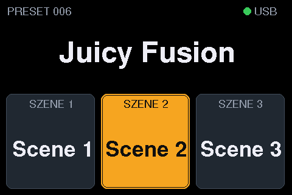

# AmperoDisplay – ESP32-S3-Anzeige für den Ampero II (Stomp)

Zeigt **Preset-Name**, die **drei Szenen-Namen** und die **aktive Szene** (orange hervorgehoben) auf dem
[LCDwiki 3.5" ESP32-S3 Display](https://www.lcdwiki.com/3.5inch_ESP32-S3_Display) (ES3C35P, ST77922, 320×480).
Der ESP32-S3 ist **USB-Host**, der Ampero hängt per USB direkt daran – kein PC nötig.



## Aufbau

| Datei | Inhalt |
|---|---|
| `AmperoDisplay.ino` | Hauptprogramm: verbindet USB, Protokoll und Anzeige |
| `UsbMidiHost.*` | USB-MIDI-Host (ESP-IDF `usb_host`): sucht das MIDI-Streaming-Interface, SysEx rein/raus |
| `AmperoClient.*` | Ampero-Protokoll: Anmeldung, Abfrage von Preset/Szene, LZO, Preset-Parsing |
| `St77922Qspi.*` | Display-Treiber (QSPI über `esp_lcd`), Init-Sequenz aus der Hersteller-Demo extrahiert |
| `Screen.*` | Layout (Adafruit GFX, Framebuffer im PSRAM) |
| `extras/host_test` | PC-Test des Protokolls gegen den Wireshark-Mitschnitt |
| `extras/preview` | PC-Vorschau des Layouts als PNG |

Ablauf: Nach dem Einstecken meldet sich der Sketch wie der Editor an (`0x05000017`), fragt
das aktuelle Preset (`0x00090000`), holt den Preset-Dump (`0x01000000`) und die Szene (`0x03000001`).
Danach wird jede Sekunde abgefragt; Szenenwechsel am Gerät kommen zusätzlich als Meldung.

## Arduino-IDE

* Boardverwalter: **esp32 by Espressif ≥ 3.1** (kompiliert mit 3.3.12)
* Bibliothek: **Adafruit GFX Library**
* Werkzeuge:
  * Board: **ESP32S3 Dev Module**
  * Flash Size: **16MB**, Partition Scheme: z. B. *16M Flash (3MB APP/9.9MB FATFS)*
  * PSRAM: **OPI PSRAM**
  * USB Mode: **USB-OTG (TinyUSB)**
  * USB CDC On Boot: **Disabled**
  * Upload Mode: *UART0 / Hardware CDC*
* Flashen: Board per USB-C an den PC, **BOOT halten und RESET drücken** (der laufende Sketch belegt
  den USB-Port als Host, deshalb braucht es den Download-Modus).
* Debug-Ausgabe: UART0 (Stecker RXD0 = IO43, TXD0 = IO44), 115200 Baud, über einen USB-Seriell-Adapter.
* `SCREEN_ROTATION` in `AmperoDisplay.ino`: 1/3 = quer, 0/2 = hoch.

## Verkabelung

Der USB-C-Port des Boards ist der native USB-Port des ESP32-S3 und wird im Host-Modus betrieben.

* **USB-OTG-Adapter** (USB-C-Stecker → USB-A-Buchse) und das normale USB-Kabel des Ampero.
* **VBUS muss am Ampero 5 V führen.** Laut Schaltplan geht VBUS der Board-Buchse nur über die Diode D8
  (B5819W) *in* das Board hinein (CC1/CC2 mit 5,1 kΩ = reine Sink). Das Board kann an seiner Buchse
  also keine 5 V ausgeben – mit einem einfachen OTG-Adapter sieht der Ampero 0 V auf VBUS. Folge:
  `E (…) HUB: Root port reset failed`.
  Lösung, eine von beiden:
  1. **OTG-Y-Kabel/-Adapter mit Strom-Einspeisung** (USB-C-Stecker zum Board, USB-A-Buchse fürs
     Ampero-Kabel, separater 5-V-Eingang für ein USB-Netzteil). Das Netzteil versorgt dann über D8 das
     Board *und* über die A-Buchse den Ampero-VBUS.
  2. **USB-2.0-Hub mit eigenem Netzteil** zwischen Board und Ampero (der ESP-IDF-Host unterstützt Hubs).
* Ein USB-C-auf-USB-C-Kabel direkt vom Board zum Ampero funktioniert nicht (beide Seiten sind Sinks).
* Der Sketch startet den Root-Port automatisch neu, solange kein Gerät erkannt wurde (alle 4 s);
  der Ampero kann also auch nachträglich eingesteckt oder eingeschaltet werden.

## Was getestet ist – und was nicht

Getestet:

* Sketch **kompiliert** ohne Warnungen (Core 3.3.12, 454 KB Flash).
* `extras/host_test`: Das Protokoll wird mit allen Gerätenachrichten aus `wireshark.pcapng` gefüttert. Ergebnis:
  alle vier Presets inkl. Szenennamen erkannt, aktive Szene korrekt, und **jeder gesendete Frame ist
  byte-identisch zu einem Frame des Hotone-Editors**.
* `extras/preview`: Das Layout wird auf dem PC gerendert (siehe Bilder dort).

**Nicht** getestet (keine Hardware hier):

1. **Display-Initialisierung** – die 63 Kommandos stammen aus der Hersteller-Demo `lv_demo_widgets.bin`
   (die Tabelle setzt das Fenster 320×480, passt also zum Panel). Falls das Bild gespiegelt/gedreht ist,
   `SCREEN_ROTATION` ändern; falls die Farben falsch sind, in `St77922Qspi.cpp` das Byte-Swapping in
   `pushFrame()` entfernen.
2. **USB Full-Speed:** Der Ampero meldet sich am PC als High-Speed-Gerät (Bulk-Endpoints 512 Byte).
   Der ESP32-S3 kann nur Full-Speed; laut USB-2.0-Spezifikation muss das Gerät dann mit 64-Byte-Paketen
   arbeiten, der Sketch liest die Endpoints deshalb aus den Deskriptoren. Hat dein RP2350-PIO-USB-Aufbau
   (ebenfalls Full-Speed) bereits SysEx vom Ampero empfangen, ist dieser Punkt praktisch geklärt.
3. Ob der Ampero ohne vorangehende 0x3800-Kurzframes (die der Editor beim Verbinden sendet) antwortet.
   Falls nach „USB-MIDI verbunden“ nichts kommt: Log auf UART0 ansehen.

## PC-Tests ausführen (Visual Studio Developer-Prompt)

```bat
cd AmperoDisplay\extras\host_test
cl /EHsc /std:c++17 /I. host_test.cpp ..\..\AmperoClient.cpp
host_test.exe ..\..\..\..\csharp\tests\Ampero.Protocol.Tests\TestData\capture_frames.txt

cd ..\preview
cl /EHsc /std:c++17 /DARDUINO=100 /I. /I"%USERPROFILE%\Documents\Arduino\libraries\Adafruit_GFX_Library" ^
   preview.cpp ..\..\Screen.cpp "%USERPROFILE%\Documents\Arduino\libraries\Adafruit_GFX_Library\Adafruit_GFX.cpp"
preview.exe && python make_png.py
```
